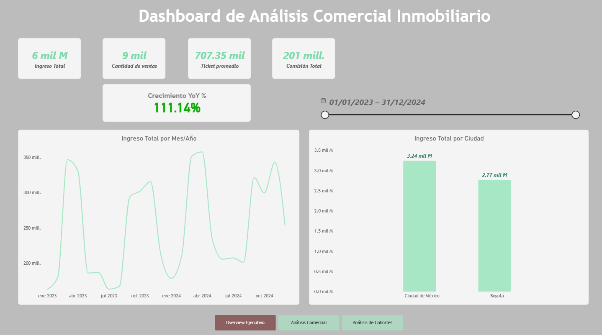
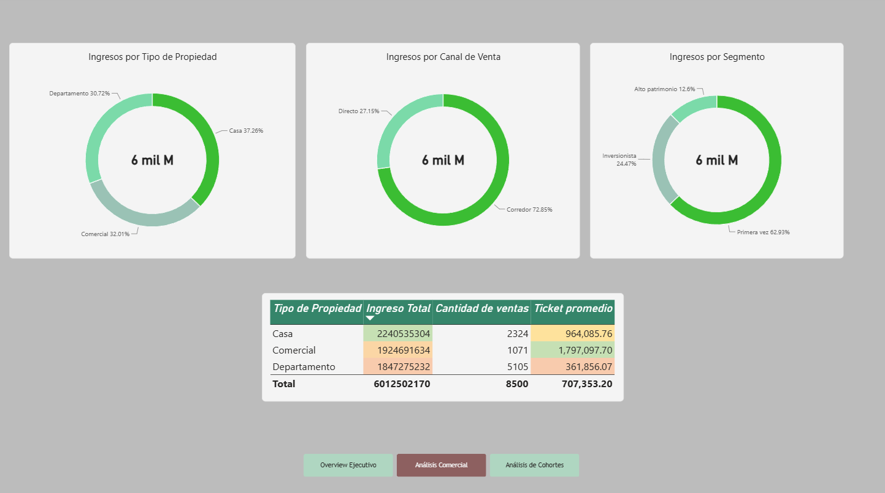
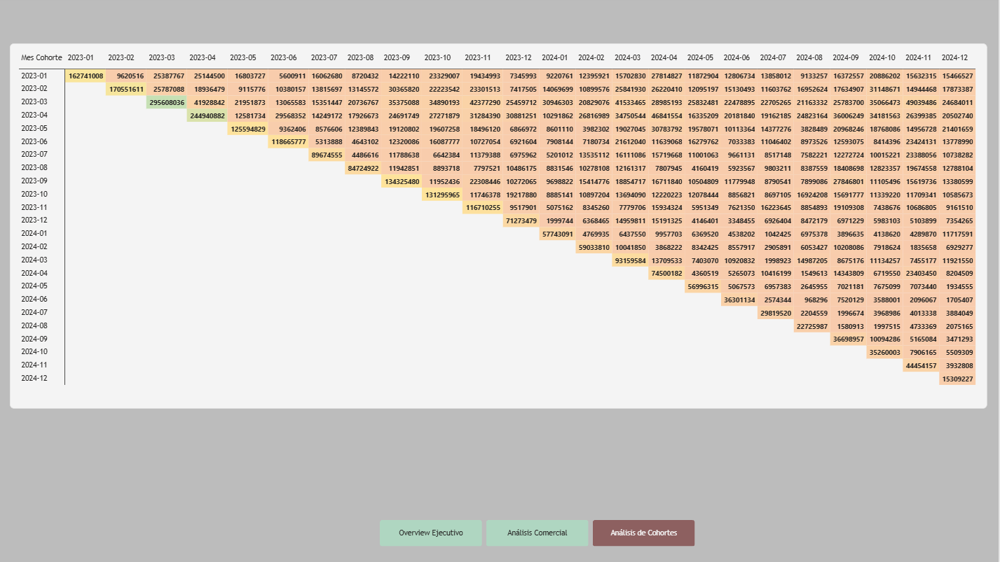

# 🏢 Dashboard de Análisis Comercial Inmobiliario (2023–2024) — Power BI

## 🎯 Objetivo del Proyecto
Construir un **dashboard ejecutivo e interactivo en Power BI** para evaluar el desempeño comercial del sector inmobiliario durante el periodo **2023–2024**, analizando ingresos, comisiones, crecimiento año contra año (YoY), mezcla de propiedades, canales de venta y comportamiento de recompra mediante **análisis de cohortes**.

---

## 🖼️ Vistas del Dashboard

### 1. Overview Ejecutivo
Seguimiento de KPIs principales (Ingreso Total, Cantidad de Ventas, Ticket Promedio, Comisión Total y Crecimiento YoY %), evolución temporal mensual y comparativo geográfico entre **Ciudad de México** y **Bogotá**, con filtro dinámico de fechas.

### 2. Análisis Comercial
Desglose de ingresos por **Tipo de Propiedad**, **Canal de Venta** y **Segmento de Cliente**, acompañado de una tabla comparativa con formato condicional para contrastar volumen de ventas frente al ticket promedio.

### 3. Análisis de Cohortes
Matriz tipo mapa de calor (*heatmap*) de cohortes mensuales (`2023-01` a `2024-12`) para evaluar la recurrencia de compra y la generación sostenida de ingresos a lo largo del tiempo según el mes de adquisición del cliente.

---

## 💡 Métricas y Hallazgos Clave
* **Desempeño global:** Se registraron **$6,012,502,170 en ingresos totales** a partir de **8,500 ventas**, con un **ticket promedio de $707,353** y **$201 millones en comisiones totales**.
* **Crecimiento sostenido:** El negocio cerró 2024 con un **crecimiento positivo YoY de 111.14%**.
* **Mercados principales:** **Ciudad de México** lidera el volumen con **$3.24 mil M**, seguida por **Bogotá** con **$2.77 mil M**.
  
* **Mix de propiedades:** **Casa** lidera la participación de ingresos con **37.26%** (2,324 ventas | ticket promedio $964,086), seguida por **Comercial** con **32.01%** (1,071 ventas | ticket promedio más alto: **$1,797,098**) y **Departamento** con **30.72%** (mayor volumen con 5,105 ventas | ticket promedio $361,856).
  
* **Canales y segmentos:** El canal **Corredor** domina ampliamente con **72.85%** del ingreso (frente a **27.15%** de canal Directo). Por segmento, **Primera vez** concentra el **62.93%** de los ingresos, seguido por **Inversionista (24.47%)** y **Alto patrimonio (12.60%)**.
  
* **Comportamiento de cohortes:** Los clientes adquiridos a principios de 2023 (especialmente enero y febrero) muestran la mayor recurrencia sostenida de ingresos en los meses posteriores.

---

## 📌 Recomendaciones Estratégicas:

1. **Priorizar propiedades tipo "Casa" y "Comercial":** Juntas representan más del **69%** de los ingresos totales y concentran los tickets promedio más altos.
 
2. **Fortalecer el canal "Corredor":** Al generar casi tres cuartas partes del *revenue* total, conviene optimizar su esquema de comisiones e incentivos para sostener el ritmo de cierre.
   
3. **Fidelizar al segmento "Primera vez":** Diseñar programas de seguimiento y recompra dirigidos a este segmento para capitalizar su alto volumen inicial y replicar la recurrencia observada en las cohortes iniciales de 2023.

---

## 📂 Estructura del Repositorio:

* `analisis_comercial_inmobiliario.ipynb`: Documentación de negocio, preguntas analíticas, resumen ejecutivo y recomendaciones estratégicas.
  
* `dashboard_comercial_inmobiliario.pbix`: Archivo interactivo de Power BI Desktop.
  
* `dashboard_overview.png` / `dashboard_comercial.png` / `dashboard_cohortes.png`: Capturas de las tres vistas del dashboard.

## 🚀 Cómo explorar el proyecto
1. Clona este repositorio: git clone https://github.com/ricardomc41-3006/analisis_comercial_inmobiliario_powerbi.git
